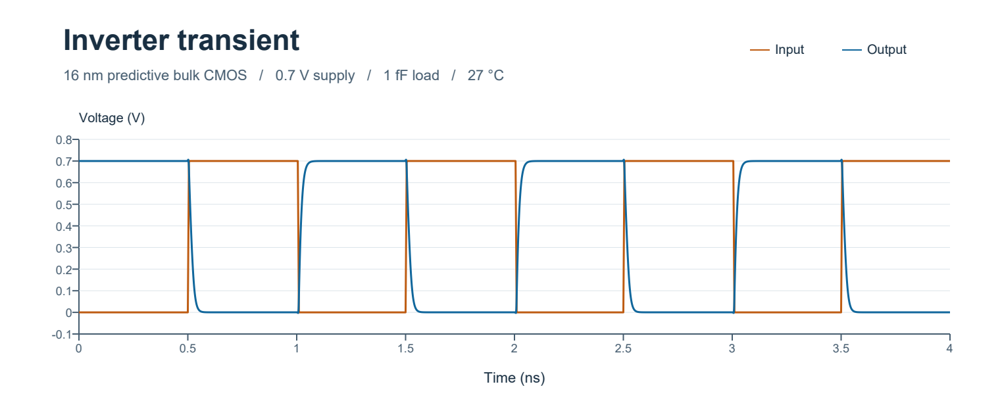
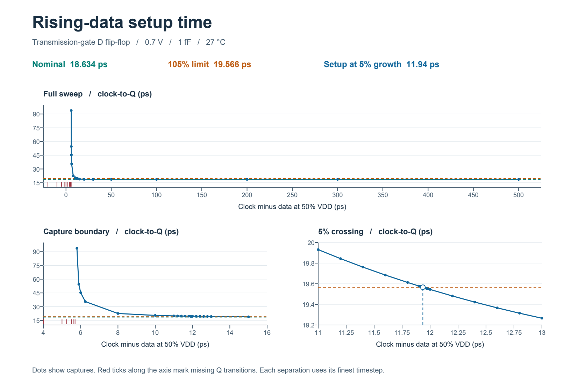

# Blind Clock and Data Recovery (CDR) — Technion VLSI Project 10703

In a high-speed serial link, the receiver uses transitions in the incoming data to determine when to sample each bit. This project begins with the sampling element itself. How much earlier must data arrive than the clock, and how much later does the output become valid as that margin shrinks?

## Milestone 1 · Transistor-level flip-flop timing

The experiment characterizes a positive-edge-triggered transmission-gate D flip-flop. It uses LTspice 24.0.12 for Windows with a public predictive 16 nm BSIM4 **bulk CMOS** model. The supply is 0.7 V, temperature 27 °C, output load 1 fF, and input transition time 5 ps. Delays use the 0.35 V crossing.

| Quantity | Result | Verification status |
| --- | ---: | --- |
| Inverter propagation, falling / rising output | 13.61 / 9.91 ps | Values from saved LTspice evidence. The students also reproduced inverter operation locally. |
| D flip-flop capture | 0, 1, 1, 0, 0, 1 | Prior LTspice run with waveform checks. Independent student reproduction pending. |
| Nominal clock-to-Q, rising output | 18.63 ps | Mean at 200, 300 and 500 ps data lead in the fine sweep. Student reproduction pending. |
| Clock-to-Q at 5% growth | 19.57 ps | Computed from the unrounded nominal value. |
| Rising-data setup at 5% growth | **11.94 ps** | Interpolated between 11.93 and 11.94 ps data lead. Student reproduction pending. |

At 5.8 ps data lead, Q took 93.78 ps to rise. At 5.7 ps, Q stayed below half supply through the 4.79 ns simulation endpoint. Those two cases illustrate delayed resolution and a missed capture. Estimating a metastability failure rate would require additional evidence. The measurements file leaves the delay field empty for a missing transition. [All 62 sweep runs](results/measurements/setup_results.csv)

## Reproduce the experiment

1. Obtain the reference model from CROW and put it beside the circuits in `simulations/ff-timing/`. Compare its SHA-256 fingerprint. [Model source and instructions](models/README.md)
2. Open `01_inverter_schematic.asc` in LTspice, click **Run**, and add traces `V(in)` and `V(out)`. Open the SPICE Error Log to compare the propagation delays.
3. For the flip-flop, run `02_flipflop_function.cir` and inspect `V(d)`, `V(clk)` and `V(q)`. The Windows batch script runs all seven inputs with the raw-file formats needed by the Python analysis. [Batch and analysis instructions](docs/setup-instructions.md)

## Repository map

| Directory | Contents |
| --- | --- |
| `simulations/ff-timing/` | Device, inverter and flip-flop LTspice sources together with their relative includes |
| `models/` | Model provenance, acquisition instructions and expected hash |
| `scripts/` | Windows LTspice runner, Python waveform analysis and plotting |
| `results/` | Figures, numerical measurements and selected LTspice log transcripts |
| `docs/` | Reproduction procedure, project plan, milestone history and issue descriptions |

LTspice produces the waveforms. Python and NumPy extract crossings. ReportLab, pypdfium2 and Pillow render the figures. Git records changes, and the collaboration workflow uses GitHub issues and pull requests. [Contribution guide](CONTRIBUTING.md)

## Current progress and scope

We have reproduced the inverter locally. Independent student reproduction of the flip-flop pattern and timing sweep is pending. The next experiment qualifies the 16 nm device model and builds a bank of ten CMOS DFFs driven by staggered taps from one master clock. The midterm evidence will be clock-to-Q delay and capture status for each tap. [Project plan](docs/project-plan.md) · [Progress log](docs/progress-log.md) · [Issue list](docs/issues.md)

This is an academic circuit experiment. The public model describes predictive planar bulk CMOS. Official TSMC N16 FinFET characterization requires foundry technology data. The results above apply to this flip-flop and testbench at the stated operating point.

## Authors

| Student | Name | GitHub profile |
| --- | --- | --- |
| 1 | Farraj Farraj | farrajfarraj |
| 2 | Daniel ryabikh | danielryabikh |
